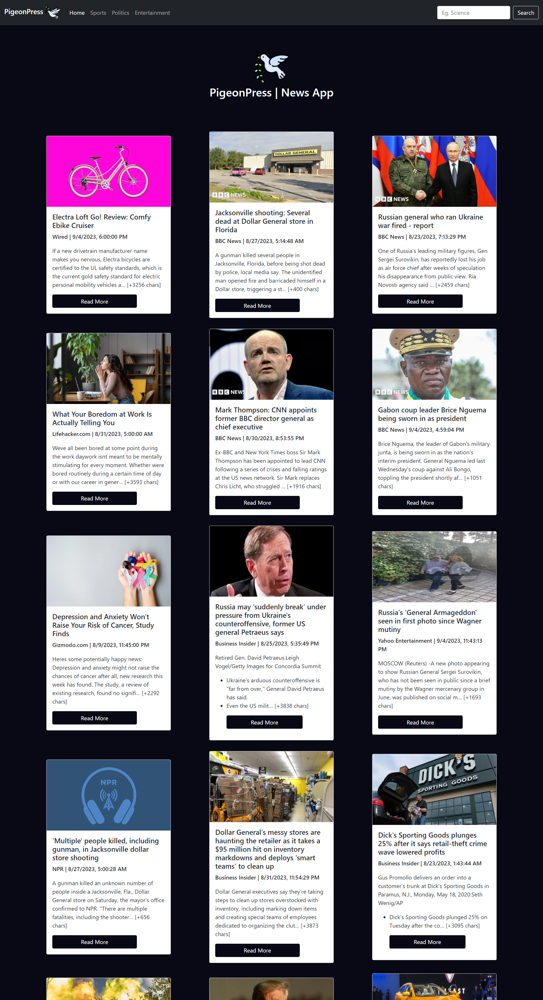

# 📰 PigeonPress — Modern News Aggregator

> A sleek, responsive news web application delivering real-time headlines, topic-based feeds, and keyword search powered by GNews and serverless edge functions.



[](#)
[](#)
[](#)
[](LICENSE)

---

## 📌 Overview

**PigeonPress** is a lightweight, responsive news discovery platform that curates top headlines and trending stories across India and globally. It bridges client-side performance with secure serverless backends:
- **Locally**: Communicates directly with news APIs for zero-friction local development.
- **In Production**: Proxies requests through **Netlify Serverless Functions** (`getNews.js`), completely eliminating CORS limitations and protecting secret API keys from public client exposure.

---

## ✨ Features

- **⚡ Category Feeds**: One-click navigation across **India**, **Sports**, **Politics**, **Entertainment**, and **Breaking News**.
- **🔍 Live Search**: Instant search functionality queryable by any topic, entity, or keyword.
- **🚀 Parallel Pagination**: Fetches multi-page article batches concurrently with `Promise.all` for snappy load times without sequential bottlenecks.
- **💾 Client-side In-memory Caching**: Caches loaded queries to preserve third-party API quotas and ensure instant repeat page navigation.
- **🛡️ Secure Serverless Proxy**: Production calls route through Netlify Edge Functions so API keys are never leaked to client bundles.
- **📱 Fully Responsive UI**: Built with Bootstrap 5 and custom CSS cards featuring cover images, publication timestamps, source tags, and smooth hover animations.

---

## 🛠️ Tech Stack

| Layer | Technology |
| :--- | :--- |
| **Frontend** | Vanilla JavaScript (ES6+), HTML5, CSS3 |
| **Styling** | Bootstrap 5, Custom Flexbox/Grid CSS |
| **Serverless / Backend** | Netlify Functions (Node.js runtime proxy) |
| **Data Provider** | GNews v4 API |
| **Hosting** | Netlify Edge CDN |

---

## 📂 Project Structure

```text
pigeon_press/
├── netlify/
│   └── functions/
│       └── getNews.js       # Serverless function proxying GNews API requests
├── images/
│   ├── favicon.png          # App favicon
│   ├── nav-logo.png         # Navigation header branding
│   └── section-logo.png     # Category icons & branding
├── index.html               # Main application layout & templates
├── app.js                   # Client-side routing, caching & DOM rendering
├── style.css                # Custom UI styling, animations & responsive rules
├── ScreenShot.png           # Application preview banner
└── README.md                # Project documentation
```

---

## 🚀 Getting Started

### Prerequisites
- Modern web browser (Chrome, Edge, Firefox, Safari)
- A free [GNews API Key](https://gnews.io/) (100 free requests/day)

### 1. Clone the Repository
```bash
git clone https://github.com/kumarrishi4981/pigeon_press.git
cd pigeon_press
```

### 2. Local Development
For local testing, the app directly communicates with GNews on `localhost`:
1. Open `app.js` and verify your `API_KEY` is set on line 8:
   ```javascript
   const API_KEY = "YOUR_GNEWS_API_KEY";
   ```
2. Serve the directory using any static file server (e.g. VS Code Live Server or Python):
   ```bash
   python -m http.server 5500
   ```
3. Open `http://localhost:5500` in your browser.

---

## ☁️ Deployment (Netlify)

PigeonPress is pre-configured for automated continuous deployment on Netlify:

1. Push your repository to **GitHub**.
2. Log into **[Netlify](https://www.netlify.com/)** and click **"Add new site"** > **"Import an existing project"**.
3. Select your `pigeon_press` repository.
4. Add the API Key under **Site Configuration > Environment variables**:
   - **Key**: `GNEWS_API_KEY`
   - **Value**: `<your_gnews_api_key>`
5. Click **Deploy Site**. Netlify will automatically detect and deploy both the static frontend and the `/netlify/functions/getNews` serverless endpoint!

---

## 🤝 Contributing

Contributions and ideas are welcome!
1. Fork the project
2. Create your feature branch (`git checkout -b feature/NewFeature`)
3. Commit your changes (`git commit -m 'Add NewFeature'`)
4. Push to the branch (`git push origin feature/NewFeature`)
5. Open a Pull Request

---

## 📄 License

This project is licensed under the MIT License - feel free to use and adapt it.

---

## 👤 Author
- **Rishi Kumar**
- GitHub: [@kumarrishi4981](https://github.com/kumarrishi4981)
